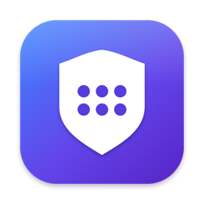
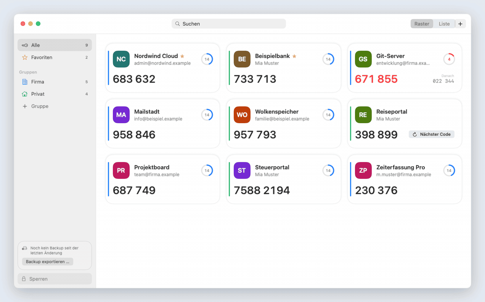
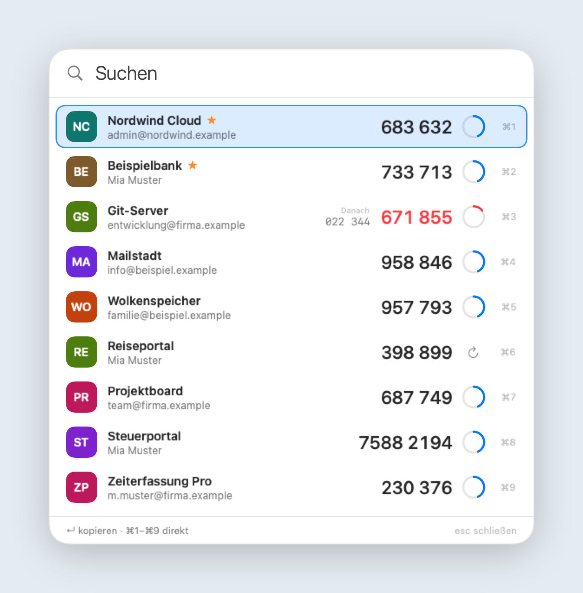
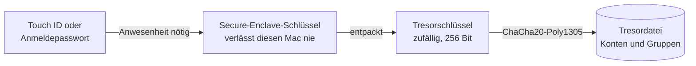

<p align="right"><a href="README.md">English</a> · <b>Deutsch</b></p>

<p align="center">
  
</p>

<h1 align="center">MacAuth</h1>

<p align="center">
  <b>Zwei-Faktor-Codes auf deinem Mac.</b><br>
  Lokal, mit der Secure Enclave verschlüsselt, einen Tastendruck entfernt.
</p>

<p align="center">
  <a href="https://github.com/fbrogno/mac-auth/releases/latest/download/MacAuth.dmg"></a>
</p>

<p align="center">
  macOS 15 oder neuer · Apple Silicon und Intel · von Apple notarisiert · kostenlos, MIT
</p>

<p align="center">
  <a href="https://github.com/fbrogno/mac-auth"></a>
  <a href="https://github.com/fbrogno/mac-auth/releases/latest"></a>
  <a href="https://github.com/fbrogno/mac-auth/releases"></a>
  <a href="https://github.com/fbrogno/mac-auth/actions/workflows/ci.yml"></a>
  <a href="LICENSE"></a>
  
  
</p>

<p align="center">
  <a href="#warum-macauth">Warum</a> ·
  <a href="#funktionen">Funktionen</a> ·
  <a href="#installation-in-30-sekunden">Installation</a> ·
  <a href="#codes-übernehmen">Import</a> ·
  <a href="#schnellzugriff">Schnellzugriff</a> ·
  <a href="#sicherheit">Sicherheit</a> ·
  <a href="#häufige-fragen">Fragen</a>
</p>

<p align="center">
  <picture>
    <source media="(prefers-color-scheme: dark)" srcset="docs/images/demo-dark.gif">
    
  </picture>
</p>
<p align="center"><sub>Die Animation besteht aus echten Bildern der App, mit erfundenen Demo-Konten.</sub></p>

MacAuth ist eine native macOS-App für Zwei-Faktor-Codes (TOTP/HOTP). Die Geheimnisse liegen verschlüsselt in einem Tresor, nur auf diesem Mac, und einen Code zu kopieren ist ein einziger Schritt.

## Warum MacAuth

- **Codes dort, wo du arbeitest.** Klick auf die Karte, `↵` oder `⌘1`–`⌘9`. Mit dem optionalen Schnellzugriff öffnet ein globales Tastenkürzel eine kleine Suche über jeder App: tippen, `↵` drücken, der Code liegt in der Zwischenablage und die vorige App hat wieder den Fokus.
- **Deine Geheimnisse bleiben auf diesem Mac.** Kein Konto, keine Cloud, keine Telemetrie. Auf einem Mac mit Secure Enclave ist der Tresorschlüssel durch einen Schlüssel geschützt, der die Enclave nie verlässt, und zum Öffnen braucht es Touch ID oder dein Anmeldepasswort.
- **Rein ist leicht, raus ist möglich.** Import aus Google Authenticator (Kamera), Apple Passwörter, Aegis, 2FAS, Ente Auth, Bitwarden, andOTP oder einer CSV-Datei. Exportiere ein Backup oder übertrage Konten als QR-Codes zurück aufs Handy.
- **Offen und nachprüfbar.** MIT-Lizenz, jeder Release ist signiert und notarisiert und hat eine SHA-256-Datei und eine Build-Provenance-Attestation. Das Bedrohungsmodell, auch was MacAuth *nicht* schützt, steht in [SECURITY.md](SECURITY.md) (englisch).

## Funktionen

<table>
  <tr>
    <td width="50%" valign="top">
      <picture>
        <source media="(prefers-color-scheme: dark)" srcset="docs/images/first-run-dark.png">
        
      </picture>
      <br><b>In einem Schritt starten</b><br>
      Erster Start: aus Google Authenticator importieren, ein Backup wiederherstellen oder ein Konto von Hand anlegen. Firma und Privat bleiben in getrennten Gruppen.
    </td>
    <td width="50%" valign="top">
      <picture>
        <source media="(prefers-color-scheme: dark)" srcset="docs/images/import-review-dark.png">
        
      </picture>
      <br><b>Nichts wird ungesehen gespeichert</b><br>
      Jeder Import endet in einer Prüfung: Duplikate sind markiert, nicht importierbare Einträge stehen mit Grund in einer Liste, und gespeichert wird erst nach deiner Bestätigung.
    </td>
  </tr>
  <tr>
    <td width="50%" valign="top">
      <picture>
        <source media="(prefers-color-scheme: dark)" srcset="docs/images/quick-access-dark.png">
        
      </picture>
      <br><b>Schnellzugriff</b><br>
      Ein Fenster wie Spotlight über jeder App, geöffnet per globalem Tastenkürzel oder Menüleisten-Symbol. Standardmäßig aus.
    </td>
    <td width="50%" valign="top">
      <picture>
        <source media="(prefers-color-scheme: dark)" srcset="docs/images/settings-dark.png">
        
      </picture>
      <br><b>Schutz, den du siehst</b><br>
      Automatische Sperre, Zwischenablage leeren, Bildschirmschutz und verborgene Codes sind Einstellungen, die du nachlesen kannst, und wer sie senkt, muss sich neu authentifizieren.
    </td>
  </tr>
</table>

Die Screenshots zeigen Demo-Daten.

- **Suche durch Tippen**, Gruppen und Favoriten, Raster- oder Listenansicht, per Ziehen sortieren.
- **Kopieren** per Klick, `↵`, `⌘1`–`⌘9`, den nächsten Code mit `⌥⌘C`. Kopierte Codes sind als verborgen markiert und werden nach 10, 30 oder 60 Sekunden (oder nie) aus der Zwischenablage gelöscht.
- **Automatische Sperre** nach Inaktivität (1, 5, 15, 60 Minuten oder nie), immer bei Ruhezustand, Bildschirmsperre und Benutzerwechsel.
- **Bildschirmschutz:** Das Fenster ist von Bildschirmfreigabe und Screenshots ausgenommen (eine Bitte an macOS, keine Garantie; abschaltbar). Optional: Codes nur bei Hover oder Auswahl sichtbar.
- **Verschlüsseltes Backup** in einem offenen, dokumentierten Format ([docs/backup-format.md](docs/backup-format.md), englisch) samt eigenständigem Entschlüsselungsskript.
- **Aufs Handy übertragen** als QR-Codes (Googles Migrationsformat oder ein `otpauth://`-QR je Konto) und unverschlüsselter Export für eine andere App (Link-Liste, Aegis-JSON, Apple-Passwörter-CSV), nach neuer Authentifizierung und mit Warnung.
- **Sichere Wiederherstellung:** Lässt sich der Tresor nicht öffnen, wird nichts gelöscht. Erneut versuchen, Backup einspielen oder eine frühere Fassung zurückholen. Eine ersetzte Tresordatei bleibt immer erhalten.
- **TOTP und HOTP**, SHA-1, SHA-256 und SHA-512, 6 bis 8 Stellen, Perioden von 15 bis 120 Sekunden.
- **Deutsche und englische** Oberfläche.

## Installation in 30 Sekunden

<p align="center">
  <a href="https://github.com/fbrogno/mac-auth/releases/latest/download/MacAuth.dmg"></a>
</p>

1. **Lade** [MacAuth.dmg](https://github.com/fbrogno/mac-auth/releases/latest/download/MacAuth.dmg) herunter (immer der neueste Release; alle Versionen stehen auf der [Release-Seite](https://github.com/fbrogno/mac-auth/releases)).
2. **Öffne sie** und ziehe MacAuth in den Ordner „Programme“.
3. **Starte MacAuth** aus „Programme“.

MacAuth ist mit Developer ID signiert und von Apple notarisiert, deshalb warnt macOS nicht vor einem nicht identifizierten Entwickler. Wie bei jeder aus dem Internet geladenen App fragt macOS beim ersten Start eventuell einmal nach, ob du sie öffnen willst: Klicke auf **Öffnen**.

Voraussetzung: macOS 15 oder neuer, Apple Silicon oder Intel (Universal-App).

## Codes übernehmen

Jeder Import endet in einem Prüfschritt. Gespeichert wird erst nach deiner Bestätigung.

| Du kommst von | So geht es |
|---|---|
| **Google Authenticator** | Am Handy: Menü, **Konten übertragen**, **Konten exportieren**, Konten wählen, ein QR-Code erscheint. In MacAuth **Aus Google Authenticator importieren** wählen und den QR-Code mit der Mac-Kamera scannen. Mehrere QR-Codes zählt MacAuth mit („2 von 3“). Ein Screenshot, eine Bilddatei oder ein einzelner `otpauth://`-Link bzw. Setup-Schlüssel gehen auch. |
| **Apple Passwörter** | In „Passwörter“: **Ablage** > **Alle Passwörter in eine Datei exportieren**. In MacAuth: **Aus Apple Passwörter**, die CSV-Datei wählen. Gelesen werden nur die Codes; die Passwörter in der Datei werden ignoriert und nie gespeichert. |
| **Aegis, 2FAS, Bitwarden, andOTP** | Dort unverschlüsselt exportieren, dann **Aus Datei importieren …** (auch im **+**-Menü und im Ablage-Menü, oder die Datei auf das Fenster ziehen). Das Format wird am Inhalt der Datei erkannt. |
| **Microsoft Authenticator** | Die App hat keinen Export und zeigt den Schlüssel eines bestehenden Kontos nie an, deshalb wird jedes Konto einmal neu eingerichtet: **Aus Microsoft Authenticator umziehen …** (erster Start, **+**-Menü, Ablage-Menü) führt dich durch. Beim Dienst die Authenticator-App neu einrichten oder eine weitere App hinzufügen, dann den QR-Code in MacAuth einfügen (`⌃⇧⌘4`, dann `⌘V`) oder den Setup-Schlüssel eingeben. Nur Android mit Root: **Aus Datei importieren …** liest die App-Datenbank `PhoneFactor` direkt, siehe [unten](#datenbank-von-microsoft-authenticator-android-mit-root). |
| **Ente Auth** | Die `otpauth://`-Liste exportieren, dann **Aus Datei importieren …**. |
| **1Password, Proton Pass, andere CSV** | Eine CSV mit Spalte für Einmalpasswörter (`OTPAuth`, `totp`, `2fa`, `otp` …) wird gelesen; alle anderen Spalten werden beim Einlesen verworfen. |
| **MacAuth-Backup** | **Backup wiederherstellen** (erster Start oder Sperrbildschirm) oder **Aus Datei importieren …**, um seine Konten hinzuzufügen. |

Exportdateien anderer Apps enthalten alle Geheimnisse im Klartext. Lösche sie nach dem Import, auch aus dem Papierkorb und aus iCloud Drive, und ebenso einen Screenshot eines QR-Codes. Lösche die Konten erst aus der alten App, wenn du geprüft hast, dass die Codes in MacAuth funktionieren. Exportiere danach ein Backup (`⇧⌘E`) und lege es sicher ab, mit einem langen Passwort.

### Datenbank von Microsoft Authenticator (Android mit Root)

Auf Android liegen die Konten in der SQLite-Datei `/data/data/com.azure.authenticator/databases/PhoneFactor`, lesbar nur mit Root-Zugriff. MacAuth erkennt die Datei am Inhalt und liest gewöhnliche Konten (6 Stellen) und private Microsoft-Konten (8 Stellen). Einträge ohne Einmalcode, etwa Geschäftskonten mit Bestätigung per Mitteilung, stehen mit Grund in der Liste und müssen beim Dienst neu eingerichtet werden. Auf dem iPhone gibt es keinen solchen Dateiweg, und das Cloud-Backup von Microsoft Authenticator können andere Apps nicht lesen.

Neben `PhoneFactor` können `PhoneFactor-wal` und `PhoneFactor-shm` liegen. Zuletzt hinzugefügte Konten stehen womöglich nur in der `-wal`-Datei, und MacAuth liest nur die eine gewählte Datei; im Prüfschritt steht ein Hinweis, wenn das der Fall sein kann. Wer sichergehen will, kopiert alle drei Dateien in einen Ordner und führt sie vorher zusammen:

```sh
sqlite3 PhoneFactor "PRAGMA wal_checkpoint(TRUNCATE);"
```

Die Datei enthält alle Schlüssel im Klartext: Lösche nach dem Import alle Kopien.

In die Gegenrichtung: **Ablage** > **Für andere App exportieren (unverschlüsselt) …**, oder Konten als QR-Codes aufs Handy übertragen.

## Schnellzugriff

Ein kleines Fenster für die häufigste Aufgabe: Konto finden, Code kopieren, aus dem Weg gehen.

- **Öffnet per globalem Tastenkürzel** (Einstellungen, Allgemein; vorgeschlagen ist ⌃⌥Space; es braucht mindestens eines von ⌘ ⌥ ⌃) und auf Wunsch über ein Menüleisten-Symbol. Standardmäßig aus; erst wenn du es einschaltest, wird etwas registriert.
- **Konto tippen**, `↵` kopiert den Code, das Fenster schließt und die vorige App hat wieder den Fokus. `⌘1`–`⌘9` kopieren eine Zeile, `⌥↵` den nächsten Code, `esc` leert oder schließt.
- **Ist MacAuth gesperrt,** zeigt das Fenster keine Kontodaten. Es bietet nur die Entsperrung an.
- Es braucht keine Bedienungshilfen-Berechtigung, tippt nichts für dich und greift nie auf das Netzwerk zu.

## Tastenkürzel

| Kürzel | Aktion |
|---|---|
| Tippen | suchen (`esc` leert) |
| `↑` `↓` `←` `→` | Auswahl bewegen |
| `↵` oder `⌘C` | Code des gewählten Kontos kopieren |
| `⌘1`–`⌘9` | Code der ersten neun sichtbaren Karten kopieren |
| `⌥⌘C` | nächsten Code kopieren |
| `⌘F` | Suche fokussieren |
| `⌘N` / `⇧⌘N` | neues Konto / neue Gruppe |
| `⇧⌘I` | importieren |
| `⌘V` | Bild oder Link zum Import einfügen |
| `⇧⌘E` | Backup exportieren |
| `⌘L` | sperren |
| `⌘⌫` | gewähltes Konto löschen (mit Rückfrage; nur bei gewählter Karte und ohne Textfeld-Fokus, nicht im Suchfeld) |
| optional | globales Kürzel für den Schnellzugriff (Einstellungen, Allgemein): Tippen sucht, `↵` kopiert, `⌘1`–`⌘9` kopieren eine Zeile, `⌥↵` den nächsten Code, `esc` leert oder schließt |
| `⌘,` | Einstellungen |

## Sicherheit

In einfachen Worten:

- Der Tresor ist eine Datei, versiegelt mit ChaCha20-Poly1305. Auf einem Mac mit Secure Enclave ist der Tresorschlüssel durch einen Schlüssel geschützt, der die Enclave nie verlässt. Zum Öffnen braucht es Touch ID oder das Anmeldepasswort, **von der Enclave erzwungen** und nicht durch eine Abfrage im Programmcode der App. Eine Kopie der Tresordatei ist auf einem anderen Gerät wertlos.
- Geheimnisse landen nie in der Zwischenablage, nur der aktuelle Code. Er ist als verborgen markiert, bleibt auf diesem Mac (kein Universelle Zwischenablage) und wird nach kurzer Zeit gelöscht.
- Das Backup nutzt AES-256-GCM mit einem Schlüssel aus deinem Passwort (PBKDF2-HMAC-SHA256, 600.000 Runden). Seine Stärke ist die Stärke deines Passworts.
- Fremdcode gibt es nur für Sparkle, den Updater. Die Kryptografie nutzt Apples CryptoKit, CommonCrypto, Security und LocalAuthentication.



Ohne Secure Enclave, oder wenn du die Entsperrabfrage abschaltest, liegt der Tresorschlüssel stattdessen im Anmeldeschlüsselbund. Das ist schwächer, und mit Time Machine oder dem Migrationsassistenten kann der Schlüssel zusammen mit der Tresordatei auf einen anderen Mac wandern. Die Einstellungen zeigen, welche Stufe aktiv ist.

**Wogegen MacAuth nicht schützt.** Schadsoftware, die als dein Benutzer läuft, während der Tresor entsperrt ist. Jemand, der dein Anmeldepasswort kennt. Passwort und zweiten Faktor auf einem Gerät zu haben: Wird dieser Mac vollständig kompromittiert, sind beide offen, überlege das also bei besonders wertvollen Konten. Ein schwaches Backup-Passwort. Und **geht der Mac ohne Backup-Datei verloren, sind die Codes weg**: Der Secure-Enclave-Schlüssel lässt sich nicht exportieren, das ist Absicht. Die vollständige Liste steht im Bedrohungsmodell in [SECURITY.md](SECURITY.md), dort auch, wie du eine Schwachstelle meldest. Der Entwurf steht in [docs/DESIGN.md](docs/DESIGN.md); beide englisch.

## Updates

MacAuth aktualisiert sich selbst mit [Sparkle](https://sparkle-project.org). Es prüft etwa alle 6 Stunden und kurz nach dem Start. Eine neue Version erscheint als Hinweis unten in der Seitenleiste und wird standardmäßig beim Beenden der App installiert. Automatische Prüfung und automatische Installation lassen sich in den Einstellungen unter Updates abschalten.

Sparkle installiert ein Update nur, wenn der Download eine gültige EdDSA-Signatur trägt, die zum öffentlichen Schlüssel in der installierten App passt, oder wenn die neue App mit derselben Developer-ID-Identität signiert ist wie die installierte. Die Release-Pipeline notarisiert die App zusätzlich; Sparkle selbst prüft die Notarisierung nicht. Das Vertrauen ruht deshalb auf der Release-Pipeline: Wer das GitHub-Repository, den Release-Workflow und seine Signatur-Geheimnisse kontrolliert, könnte ein Update ausliefern, das jede installierte Kopie annimmt. Kannst du das nicht akzeptieren, schalte die automatische Installation ab und installiere Releases nach eigener Prüfung von Hand. Einzelheiten in [SECURITY.md](SECURITY.md#releases).

## Datenschutz

MacAuth sammelt keine Daten. Die einzige Netzwerkverbindung ist die Update-Prüfung bei den GitHub Releases dieses Repositorys. Sie sendet keine Kontodaten, Kennungen oder Nutzungsdaten; wie bei jeder Webanfrage sieht GitHub die Anfrage selbst, etwa deine IP-Adresse. Die Kamera wird nur zum Scannen eines QR-Codes beim Import benutzt; die Bilder werden auf dem Gerät verarbeitet und nichts wird aufgezeichnet. Siehe [PRIVACY.md](PRIVACY.md) (englisch).

## Download prüfen

Jeder Release hat eine SHA-256-Datei und eine Build-Provenance-Attestation von GitHub Actions (Sigstore). Im Ordner mit dem Download:

```bash
# Stammt die Datei aus dem Release-Workflow dieses Repositorys?
gh attestation verify MacAuth.dmg --repo fbrogno/mac-auth

# Passt der Hash? Vergleiche mit dem Wert in MacAuth-<Version>.dmg.sha256 auf der Release-Seite.
shasum -a 256 MacAuth.dmg

# Signatur und Notarisierung der DMG
spctl -a -vv -t open --context context:primary-signature MacAuth.dmg
```

`MacAuth.dmg` ist eine byte-gleiche Kopie von `MacAuth-<Version>.dmg`, beide Prüfungen funktionieren also für beide Dateinamen. Mehr in [docs/RELEASING.md](docs/RELEASING.md).

## Selbst bauen

Du brauchst macOS 15+, Xcode und [XcodeGen](https://github.com/yonaskolb/XcodeGen).

```bash
swift test                               # Tests für AuthCore
SIGN_IDENTITY=- ./scripts/build-app.sh   # build/MacAuth.app, ad hoc signiert
```

Ausprobieren, ohne einen Tresor anzufassen: `build/MacAuth.app/Contents/MacOS/MacAuth --demo` öffnet das echte Fenster mit erfundenen Konten, komplett im Speicher (kein Tresor, kein Schlüsselbund, keine Secure Enclave, nichts wird gespeichert). `--render-docs <Ordner>` zeichnet die Dokumentationsbilder aus denselben Ansichten.

## Häufige Fragen

<details>
<summary><b>Wird etwas von meinen Daten irgendwohin gesendet?</b></summary>

Nein. Konten, Geheimnisse und Codes verlassen deinen Mac nie. Die einzige Verbindung, die MacAuth öffnet, ist die Update-Prüfung bei GitHub Releases; sie sendet keine Kontodaten oder Kennungen. Siehe [PRIVACY.md](PRIVACY.md) (englisch).
</details>

<details>
<summary><b>Was, wenn ich meinen Mac verliere?</b></summary>

Ohne Backup-Datei sind die Codes weg: Der Secure-Enclave-Schlüssel lässt sich nicht exportieren, das ist Absicht. Exportiere ein verschlüsseltes Backup (`⇧⌘E`) und bewahre es sicher auf, mit einem langen Passwort. Auf einem neuen Mac spielst du es mit **Backup wiederherstellen** ein. MacAuth erinnert dich, wenn es kein Backup der letzten Änderungen gibt.
</details>

<details>
<summary><b>Kann ich zurück aufs Handy wechseln?</b></summary>

Ja. **Auf Handy übertragen** zeigt QR-Codes in Googles Migrationsformat oder je Konto einen `otpauth://`-QR-Code. Konten, die Googles Format nicht abbilden kann (zum Beispiel andere Perioden als 30 Sekunden oder 7 Stellen), werden abgelehnt statt still verändert; sie lassen sich als einzelne QR-Codes übertragen. Du kannst auch eine Datei für eine andere App exportieren.
</details>

<details>
<summary><b>Warum fragt die App nach Touch ID?</b></summary>

Auf einem Mac mit Secure Enclave lässt sich der Schlüssel, der den Tresorschlüssel schützt, erst nach Touch ID oder Anmeldepasswort benutzen. Das erzwingt die Enclave, nicht eine Abfrage in der App, und genau deshalb ist eine Kopie der Tresordatei anderswo wertlos. Funktioniert der Sensor nicht, geht es mit dem Anmeldepasswort.
</details>

<details>
<summary><b>Wird zwischen meinen Macs synchronisiert?</b></summary>

Nein. Es gibt keine Cloud und keine Synchronisation. Der Tresor ist an einen Mac gebunden; für dieselben Konten anderswo spielst du dort ein Backup ein.
</details>

<details>
<summary><b>Kann ich Touch ID oder die automatische Sperre abschalten?</b></summary>

Du kannst den Schutz in den Einstellungen senken, aber jeder Schritt braucht eine neue Authentifizierung, und die Einstellung liegt im verschlüsselten Tresor, sodass sie sich nicht durch Bearbeiten von Einstellungsdateien senken lässt. Schaltest du die Entsperrabfrage ab, liegt der Tresorschlüssel im Anmeldeschlüsselbund, das ist schwächer (siehe Sicherheit oben).
</details>

<details>
<summary><b>Das Kürzel für den Schnellzugriff tut nichts.</b></summary>

Vielleicht belegt eine andere App dieselbe Tastenkombination; macOS meldet das MacAuth nicht. Wähle in den Einstellungen unter Allgemein ein anderes Kürzel.
</details>

<details>
<summary><b>Funktioniert MacAuth mit meinem Dienst?</b></summary>

Mit jedem Dienst, der Codes für Standard-Authenticator-Apps anbietet (TOTP oder HOTP, RFC 6238 und RFC 4226). Codes im Steam-Stil werden nicht unterstützt; solche Einträge stehen beim Import in der Liste der nicht nutzbaren.
</details>

## Mitmachen

Fehlerberichte und kleine, gezielte Pull Requests sind willkommen; bei Größerem bitte zuerst ein Issue öffnen. Aufbau, Stil und Ablauf eines Pull Requests stehen in [CONTRIBUTING.md](CONTRIBUTING.md) (englisch). Sicherheitsproblem gefunden? Bitte kein öffentliches Issue, siehe [SECURITY.md](SECURITY.md).

Wenn dir MacAuth hilft, hilft ein Stern auf GitHub anderen, es zu finden:

<p align="center">
  <a href="https://github.com/fbrogno/mac-auth"></a>
</p>

## Lizenz

[MIT](LICENSE). MacAuth steht in keinem Zusammenhang mit Google. „Google Authenticator“ ist eine Marke von Google LLC.
