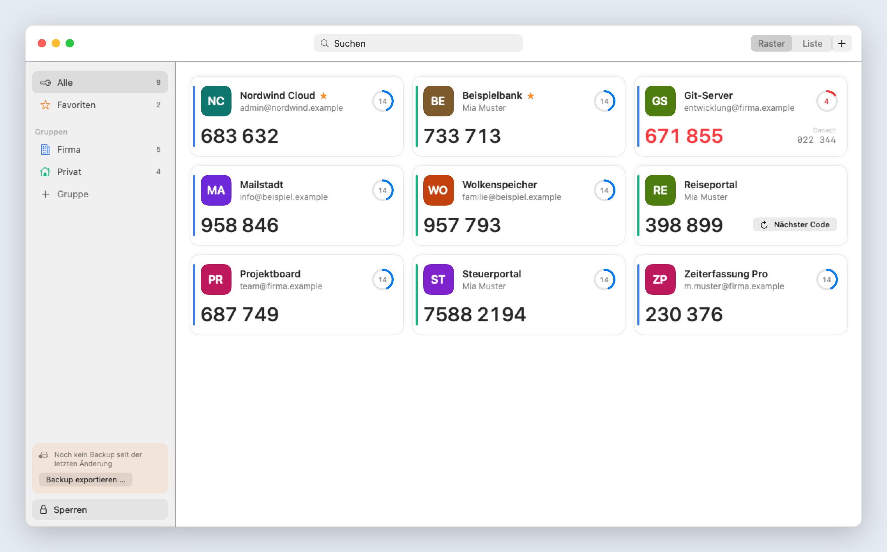
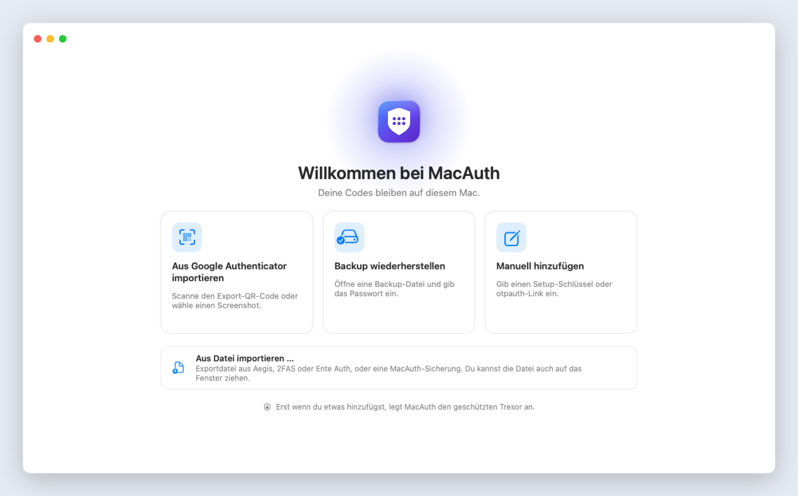
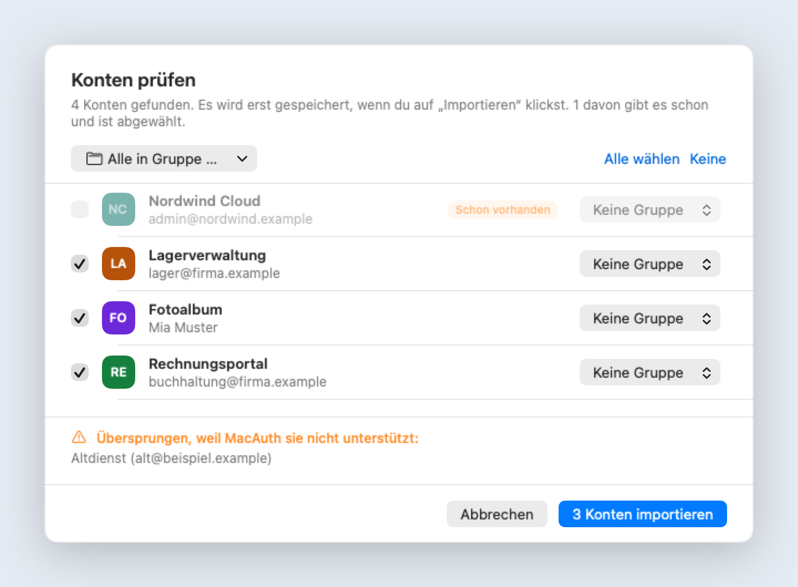
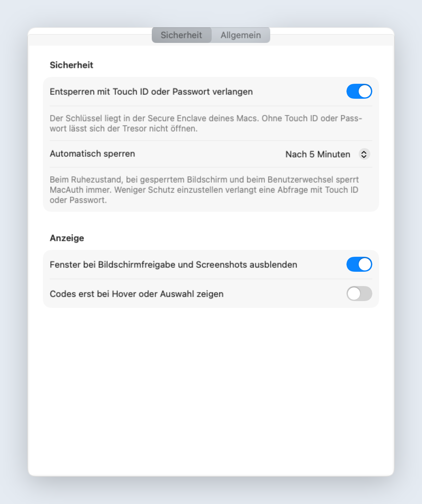

[English](README.md) · **Deutsch**

<p align="center">
  <picture>
    <source media="(prefers-color-scheme: dark)" srcset="docs/images/main-grid-dark.png">
    
  </picture>
</p>

# MacAuth

MacAuth ist eine native macOS-App für Zwei-Faktor-Codes (TOTP/HOTP). Die Geheimnisse liegen verschlüsselt in einem Tresor, nur auf diesem Mac, und einen Code zu kopieren ist ein einziger Schritt.

## Warum

- 2FA-Codes dort, wo du arbeitest: am Mac, einen Klick oder Tastendruck entfernt.
- Firma und Privat bleiben getrennt, in Gruppen („Firma“ und „Privat“ legt MacAuth beim ersten Start an).
- Übernimmt deine Konten aus Google Authenticator.
- Alles bleibt lokal: kein Konto, keine Cloud, keine Telemetrie. Siehe [PRIVACY.md](PRIVACY.md) (englisch).

## Funktionen

- Import aus Google Authenticator per Mac-Kamera (empfohlen), Bilddatei oder Screenshot (öffnen, hineinziehen, einfügen) oder per einzelnem `otpauth://`-Link bzw. Setup-Schlüssel.
- Import aus Dateien: Aegis, 2FAS, Ente Auth (`otpauth://`-Liste), Bitwarden (JSON), andOTP, CSV-Dateien von Passwortmanagern (Apple Passwörter, 1Password, Proton Pass u. a.) und MacAuth-Backups. Das Format wird am Inhalt der Datei erkannt. Es gehen nur unverschlüsselte Exporte; lösche die Exportdatei danach, sie enthält alle Schlüssel im Klartext. Aus Passwortmanagern werden nur die Codes gelesen: Passwörter in der Datei werden ignoriert und nie gespeichert.
- Jeder Import endet in einem Prüfschritt; gespeichert wird erst nach deiner Bestätigung, Duplikate sind markiert, nicht importierbare Einträge stehen mit Grund in einer Liste.
- Code kopieren per Klick auf die Karte, mit `↵` oder mit `⌘1`–`⌘9`. Den nächsten Code kopierst du mit `⌥⌘C`.
- Suche durch bloßes Tippen; Gruppen und Favoriten; Raster- oder Listenansicht.
- Tresor mit Schlüsselschutz in der Secure Enclave und Touch ID (oder Anmeldepasswort).
- Optionaler Schnellzugriff (standardmäßig aus): ein globales Tastenkürzel (braucht mindestens eines von ⌘ ⌥ ⌃) und auf Wunsch ein Symbol in der Menüleiste öffnen ein kleines Fenster über jeder App. Konto tippen, `↵` kopiert den Code, das Fenster schließt und die vorige App hat wieder den Fokus. Ist MacAuth gesperrt, bietet das Fenster nur die Entsperrung an.
- Lässt sich der Tresor nicht öffnen, wird nichts gelöscht: erneut versuchen, Backup einspielen oder eine frühere Fassung zurückholen (**Frühere Fassung wiederherstellen**). Eine ersetzte Tresordatei bleibt immer erhalten.
- Automatische Sperre nach Inaktivität (1, 5, 15, 60 Minuten oder nie), immer beim Ruhezustand, gesperrtem Bildschirm und Benutzerwechsel.
- Kopierte Codes sind als vertraulich markiert und werden nach 10, 30 oder 60 Sekunden (oder nie) aus der Zwischenablage entfernt.
- Fenster wird von Bildschirmfreigabe und Screenshots ausgenommen (eine Bitte an macOS, keine Garantie; abschaltbar); optional Codes erst bei Hover oder Auswahl.
- Verschlüsselte Backup-Datei mit offenem, dokumentiertem Format ([docs/backup-format.md](docs/backup-format.md), englisch).
- Konten aufs Handy übertragen als QR-Codes (Googles Übertragungsformat oder je Konto ein `otpauth://`-QR).
- Export für eine andere App, unverschlüsselt und nur nach frischer Authentifizierung und einer Warnung: Link-Liste (`otpauth://`, `.txt`), Aegis (`.json`) oder Apple Passwörter (`.csv`). Die Datei wird nur für dich lesbar angelegt; Konten, die ein Format nicht fassen kann (etwa HOTP in der Passwörter-CSV), werden aufgelistet, nie stillschweigend verändert.
- Oberfläche auf Deutsch und Englisch.

<table>
  <tr>
    <td width="50%"><picture><source media="(prefers-color-scheme: dark)" srcset="docs/images/first-run-dark.png"></picture></td>
    <td width="50%"><picture><source media="(prefers-color-scheme: dark)" srcset="docs/images/import-review-dark.png"></picture></td>
  </tr>
</table>

Die Bilder zeigen Demodaten.

## Installation

1. Lade die DMG von der [aktuellen Release-Seite](https://github.com/fbrogno/mac-auth/releases/latest).
2. Öffne sie und ziehe MacAuth in den Ordner „Programme“.

Voraussetzung: macOS 15 oder neuer. Die App ist mit Developer ID signiert und von Apple notarisiert. Sie aktualisiert sich selbst (Sparkle, signierte Updates); neue Versionen erscheinen als Hinweis in der Seitenleiste und werden standardmäßig beim Beenden installiert; automatische Prüfung und automatische Installation lassen sich abschalten.

Releases lassen sich nachprüfen: Jeder hat eine SHA-256-Datei (`shasum -a 256 -c MacAuth-<Version>.dmg.sha256`) und eine Build-Provenance-Attestation von GitHub Actions (`gh attestation verify MacAuth-<Version>.dmg --repo fbrogno/mac-auth`).

## Erste Schritte

1. In Google Authenticator auf dem Handy: Menü, **Konten übertragen**, **Konten exportieren**, Konten auswählen. Es erscheint ein QR-Code.
2. In MacAuth **Aus Google Authenticator importieren** wählen und den QR-Code mit der Mac-Kamera scannen. Umfasst der Export mehrere QR-Codes, zählt MacAuth mit („2 von 3“).
3. Liste prüfen, Gruppe wählen, importieren.
4. Danach ein Backup exportieren (`⇧⌘E`) und sicher ablegen. Nimm ein langes Passwort; es schützt die Datei.

Lösche die Konten erst aus Google Authenticator, wenn du geprüft hast, dass die Codes in MacAuth funktionieren.

Du kommst von Aegis, 2FAS, Ente Auth, Bitwarden oder andOTP? Exportiere dort unverschlüsselt und wähle dann **Aus Datei importieren …** (auch im **+**-Menü und im Ablage-Menü, oder ziehe die Datei auf das Fenster). Ein verschlüsselter Export muss dort erst unverschlüsselt exportiert werden. Lösche die Exportdatei danach, auch aus dem Papierkorb und aus iCloud Drive. Dasselbe gilt für einen Screenshot eines QR-Codes, auch in iCloud-Fotos.

Du kommst von Apple Passwörter? Wähle in der App „Passwörter“ **Ablage** > **Alle Passwörter in eine Datei exportieren**, dann in MacAuth **Aus Apple Passwörter** (im Import-Fenster) und die CSV-Datei. MacAuth liest nur die Codes; die Passwörter in der Datei werden ignoriert und nicht gespeichert. Die Datei selbst enthält alle deine Passwörter: lösche sie direkt nach dem Import. In die Gegenrichtung schreibt **Ablage** > **Für andere App exportieren (unverschlüsselt) …** eine CSV für die App „Passwörter“, eine Link-Liste oder eine Aegis-Datei.

<p align="center">
  <picture>
    <source media="(prefers-color-scheme: dark)" srcset="docs/images/settings-dark.png">
    
  </picture>
</p>

<p align="center">
  <picture>
    <source media="(prefers-color-scheme: dark)" srcset="docs/images/quick-access-dark.png">
    
  </picture>
</p>

## Tastenkürzel

| Kürzel | Aktion |
|---|---|
| Tippen | suchen (`esc` leert) |
| `↑` `↓` `←` `→` | Auswahl bewegen |
| `↵` oder `⌘C` | Code des gewählten Kontos kopieren |
| `⌘1`–`⌘9` | Code der ersten neun sichtbaren Karten kopieren |
| `⌥⌘C` | nächsten Code kopieren |
| `⌘F` | Suche fokussieren |
| `⌘N` / `⇧⌘N` | neues Konto / neue Gruppe |
| `⇧⌘I` | importieren |
| `⌘V` | Bild oder Link zum Import einfügen |
| `⇧⌘E` | Backup exportieren |
| `⌘L` | sperren |
| `⌘⌫` | gewähltes Konto löschen (mit Rückfrage; nur bei gewählter Karte und ohne Textfeld-Fokus, nicht im Suchfeld) |
| optional | globales Kürzel für den Schnellzugriff (Einstellungen, Allgemein): Tippen sucht, `↵` kopiert, `⌘1`–`⌘9` kopieren eine Zeile, `⌥↵` den nächsten Code, `esc` leert oder schließt |
| `⌘,` | Einstellungen |

## Sicherheit

- Der Tresor ist eine Datei, versiegelt mit ChaCha20-Poly1305. Auf einem Mac mit Secure Enclave ist der Tresorschlüssel durch einen Schlüssel geschützt, der die Enclave nie verlässt; zum Öffnen braucht es Touch ID oder das Anmeldepasswort, von der Enclave erzwungen. Ohne Enclave (oder wenn du die Abfrage abschaltest) liegt der Schlüssel im Anmeldeschlüsselbund, das ist schwächer; dann kann der Schlüssel mit Time Machine oder dem Migrationsassistenten zusammen mit der Tresordatei auf einen anderen Mac wandern.
- Geheimnisse landen nie in der Zwischenablage, nur der aktuelle Code.
- Das Backup nutzt AES-256-GCM mit einem Schlüssel aus deinem Passwort (PBKDF2-HMAC-SHA256, 600.000 Runden). Seine Stärke ist die Stärke deines Passworts.
- **Ohne Backup-Datei sind die Codes weg, wenn der Mac verloren geht** oder gelöscht wird. Der Secure-Enclave-Schlüssel lässt sich nicht exportieren. Das ist Absicht.
- Passwort und zweiten Faktor auf einem Gerät zu haben, ist eine bewusste Abwägung. Wird dieser Mac vollständig kompromittiert, sind beide offen. Überlege das bei besonders wertvollen Konten.
- Nicht abgedeckt: Schadsoftware, die als dein Benutzer läuft, während der Tresor entsperrt ist, und ein Angreifer, der dein Anmeldepasswort kennt.

Das Bedrohungsmodell steht in [SECURITY.md](SECURITY.md) (dort auch, wie du eine Schwachstelle meldest), der Entwurf in [docs/DESIGN.md](docs/DESIGN.md); beide englisch.

## Selbst bauen

Du brauchst macOS 15+, Xcode und [XcodeGen](https://github.com/yonaskolb/XcodeGen).

```bash
swift test                               # Tests für AuthCore
SIGN_IDENTITY=- ./scripts/build-app.sh   # build/MacAuth.app, ad hoc signiert
```

Ausprobieren, ohne einen Tresor anzufassen: `build/MacAuth.app/Contents/MacOS/MacAuth --demo` öffnet das echte Fenster mit erfundenen Konten, komplett im Speicher (kein Tresor, kein Schlüsselbund, keine Secure Enclave, nichts wird gespeichert). `--render-docs <Ordner>` zeichnet die Dokumentationsbilder aus denselben Ansichten.

Aufbau, Stil und Ablauf eines Pull Requests stehen in [CONTRIBUTING.md](CONTRIBUTING.md) (englisch).

## Lizenz

[MIT](LICENSE). MacAuth steht in keinem Zusammenhang mit Google. „Google Authenticator“ ist eine Marke von Google LLC.
