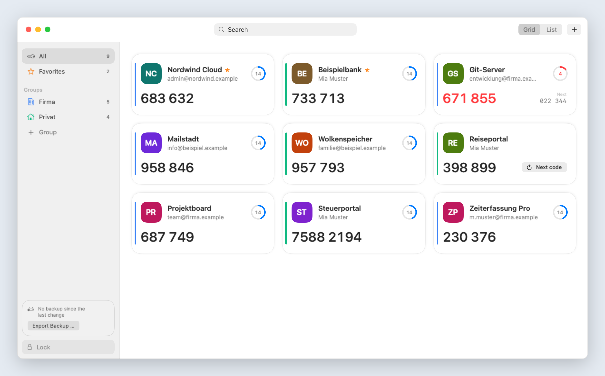
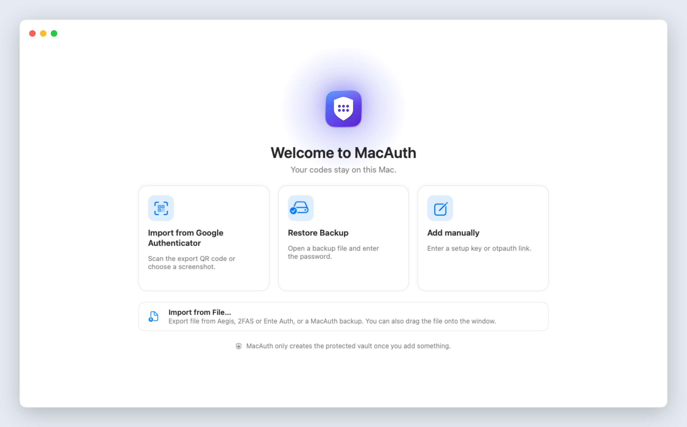
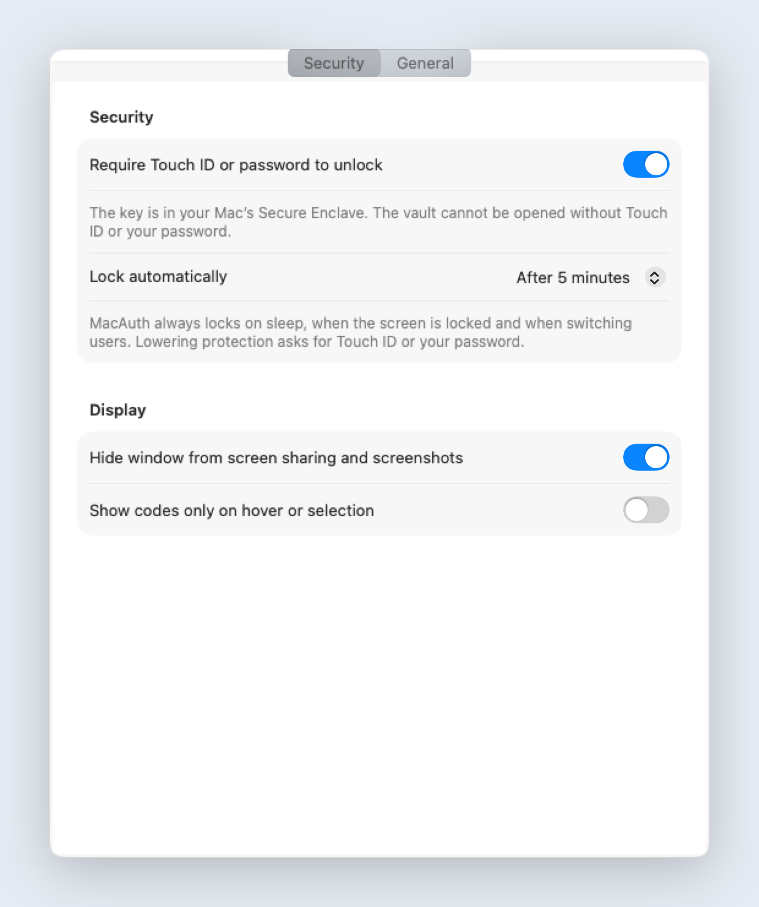
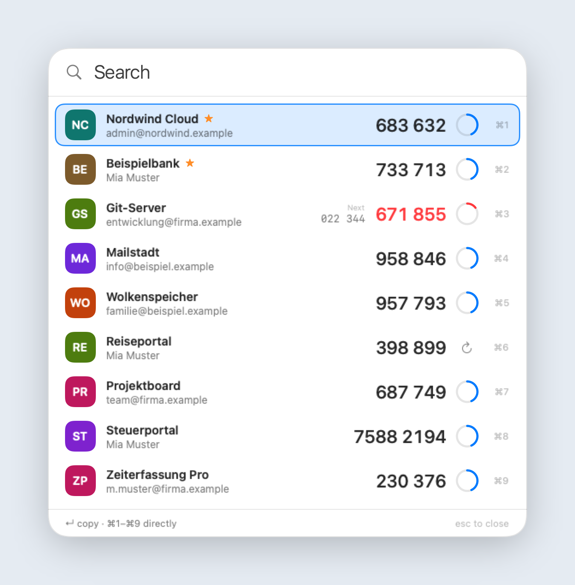

**English** · [Deutsch](README.de.md)

<p align="center">
  <picture>
    <source media="(prefers-color-scheme: dark)" srcset="docs/images/main-grid-dark-en.png">
    
  </picture>
</p>

# MacAuth

MacAuth is a native macOS app for two-factor codes (TOTP/HOTP). It keeps your secrets in an encrypted vault on this Mac only and makes copying a code a single step.

## Why

- 2FA codes where you work: on the Mac, one click or keystroke away.
- Work and private accounts stay apart, in groups ("Firma" and "Privat" are created on first start).
- Moves your accounts over from Google Authenticator.
- Everything is local: no account, no cloud, no telemetry. See [PRIVACY.md](PRIVACY.md).

## Features

- Import from Google Authenticator via the Mac camera (recommended), an image file or screenshot (open, drag, paste), or a single `otpauth://` link or setup key.
- Import from files: Aegis, 2FAS, Ente Auth (`otpauth://` list), Bitwarden (JSON), andOTP, password-manager CSV files (Apple Passwords, 1Password, Proton Pass and others) and MacAuth backups. The format is recognised from the file content. Only unencrypted exports work; delete the export file afterwards, it holds all your keys in plain text. From password managers only the codes are read: passwords in the file are ignored and never stored.
- Every import ends in a review step; nothing is stored until you confirm, duplicates are marked, entries that cannot be imported are listed with the reason.
- Copy a code by clicking its card, with `↵` or with `⌘1`–`⌘9`. The next code is copied with `⌥⌘C`.
- Search by just typing; groups and favorites; grid or list view.
- Vault with Secure Enclave key protection and Touch ID (or login password).
- Optional quick access (off by default): a global shortcut (needs at least one of ⌘ ⌥ ⌃) and, if you like, a menu bar icon open a small panel over any app. Type to find an account, `↵` copies the code, the panel closes and the previous app has the focus again. While MacAuth is locked the panel only offers to unlock.
- If the vault cannot be opened, nothing is deleted: try again, restore a backup or bring back an earlier version (**Restore Earlier Version**). A replaced vault file is always kept.
- Auto-lock after inactivity (1, 5, 15, 60 minutes or never), and always on sleep, screen lock and user switching.
- Copied codes are marked as concealed and cleared from the clipboard after 10, 30 or 60 seconds (or never).
- Window excluded from screen sharing and screenshots (a request to macOS, no guarantee; can be switched off); optional: codes shown only on hover or selection.
- Encrypted backup file with an open, documented format ([docs/backup-format.md](docs/backup-format.md)).
- Transfer accounts to a phone as QR codes (Google's migration format, or one `otpauth://` QR per account).
- Export for another app, unencrypted and only after a fresh authentication and a warning: link list (`otpauth://`, `.txt`), Aegis (`.json`) or Apple Passwords (`.csv`). The file is written readable by you only; accounts a format cannot hold (for example HOTP in the Passwords CSV) are listed, never changed silently.
- German and English interface.

<table>
  <tr>
    <td width="50%"><picture><source media="(prefers-color-scheme: dark)" srcset="docs/images/first-run-dark-en.png"></picture></td>
    <td width="50%"><picture><source media="(prefers-color-scheme: dark)" srcset="docs/images/import-review-dark-en.png"></picture></td>
  </tr>
</table>

The screenshots show demo data.

## Install

1. Download the DMG from the [latest release](https://github.com/fbrogno/mac-auth/releases/latest).
2. Open it and drag MacAuth to Applications.

Requires macOS 15 or newer. The app is signed with a Developer ID and notarized by Apple. It updates itself (Sparkle, signed updates); new versions are shown as a notice in the sidebar and, by default, installed when you quit; you can switch automatic checks and automatic installation off.

Releases can be verified: each has a SHA-256 file (`shasum -a 256 -c MacAuth-<version>.dmg.sha256`) and a build provenance attestation from GitHub Actions (`gh attestation verify MacAuth-<version>.dmg --repo fbrogno/mac-auth`).

## Getting started

1. In Google Authenticator on your phone: menu, **Transfer accounts**, **Export accounts**, select accounts. A QR code appears.
2. In MacAuth choose **Import from Google Authenticator** and scan the QR code with the Mac camera. If the export spans several QR codes, MacAuth counts them ("2 of 3").
3. Check the list, pick a group, import.
4. Then export a backup (`⇧⌘E`) and store it somewhere safe. Use a long password; it protects the file.

Do not delete the accounts from Google Authenticator before you have checked that the codes in MacAuth work.

Coming from Aegis, 2FAS, Ente Auth, Bitwarden or andOTP? Export unencrypted there, then choose **Import from File …** (also in the **+** menu and the File menu, or drop the file on the window). An encrypted export has to be exported unencrypted first. Delete the export file afterwards, also from the Trash and from iCloud Drive. The same goes for a screenshot of a QR code, including iCloud Photos.

Coming from Apple Passwords? In the Passwords app choose **File** > **Export All Passwords to File**, then in MacAuth **From Apple Passwords** (in the import dialog) and pick the CSV. MacAuth reads only the codes; the passwords in the file are ignored and not stored. The file itself holds all your passwords: delete it right after the import. Going the other way, **File** > **Export for Another App (Unencrypted) …** writes a CSV for the Passwords app, a link list or an Aegis file.

<p align="center">
  <picture>
    <source media="(prefers-color-scheme: dark)" srcset="docs/images/settings-dark-en.png">
    
  </picture>
</p>

<p align="center">
  <picture>
    <source media="(prefers-color-scheme: dark)" srcset="docs/images/quick-access-dark-en.png">
    
  </picture>
</p>

## Keyboard shortcuts

| Shortcut | Action |
|---|---|
| typing | search (`esc` clears) |
| `↑` `↓` `←` `→` | move selection |
| `↵` or `⌘C` | copy code of the selected account |
| `⌘1`–`⌘9` | copy code of the first nine visible cards |
| `⌥⌘C` | copy the next code |
| `⌘F` | focus search |
| `⌘N` / `⇧⌘N` | new account / new group |
| `⇧⌘I` | import |
| `⌘V` | paste an image or link to import |
| `⇧⌘E` | export backup |
| `⌘L` | lock |
| `⌘⌫` | delete the selected account (with confirmation; only when a card is selected and no text field has focus, not in the search field) |
| optional | global shortcut for quick access (Settings, General): typing finds, `↵` copies, `⌘1`–`⌘9` copy a row, `⌥↵` the next code, `esc` clears or closes |
| `⌘,` | settings |

## Security

- The vault is one file, sealed with ChaCha20-Poly1305. On a Mac with a Secure Enclave the vault key is wrapped by a key that never leaves it; opening needs Touch ID or the login password, enforced by the enclave. Without it (or if you switch the prompt off) the key sits in the login keychain, which is weaker, and with Time Machine or Migration Assistant the key can travel to another Mac together with the vault file.
- Secrets are never put on the clipboard, only the current code.
- The backup is AES-256-GCM with a key from your password (PBKDF2-HMAC-SHA256, 600,000 rounds). Its strength is the strength of your password.
- **Without a backup file, the codes are gone if you lose the Mac** or erase it. The Secure Enclave key cannot be exported. That is intended.
- Having password and second factor on one device is a deliberate trade-off. If that Mac is fully compromised, both are exposed. Think twice for high-value accounts.
- Not covered: malware running as you while the vault is unlocked, an attacker who knows your login password.

The threat model is in [SECURITY.md](SECURITY.md) (which also explains how to report a vulnerability), the design in [docs/DESIGN.md](docs/DESIGN.md).

## Build from source

You need macOS 15+, Xcode and [XcodeGen](https://github.com/yonaskolb/XcodeGen).

```bash
swift test                               # tests for AuthCore
SIGN_IDENTITY=- ./scripts/build-app.sh   # build/MacAuth.app, ad-hoc signed
```

Try it without touching a vault: `build/MacAuth.app/Contents/MacOS/MacAuth --demo` opens the real window with invented accounts, entirely in memory (no vault, keychain or Secure Enclave, nothing is stored). `--render-docs <folder>` draws the documentation images from the same views.

See [CONTRIBUTING.md](CONTRIBUTING.md) for the layout, style and how to send a pull request.

## License

[MIT](LICENSE). MacAuth is not affiliated with Google. "Google Authenticator" is a trademark of Google LLC.
