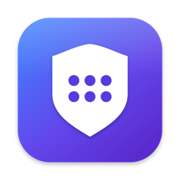
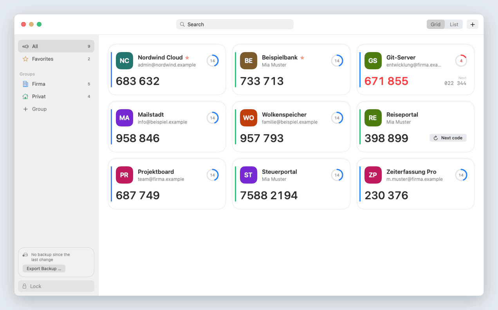
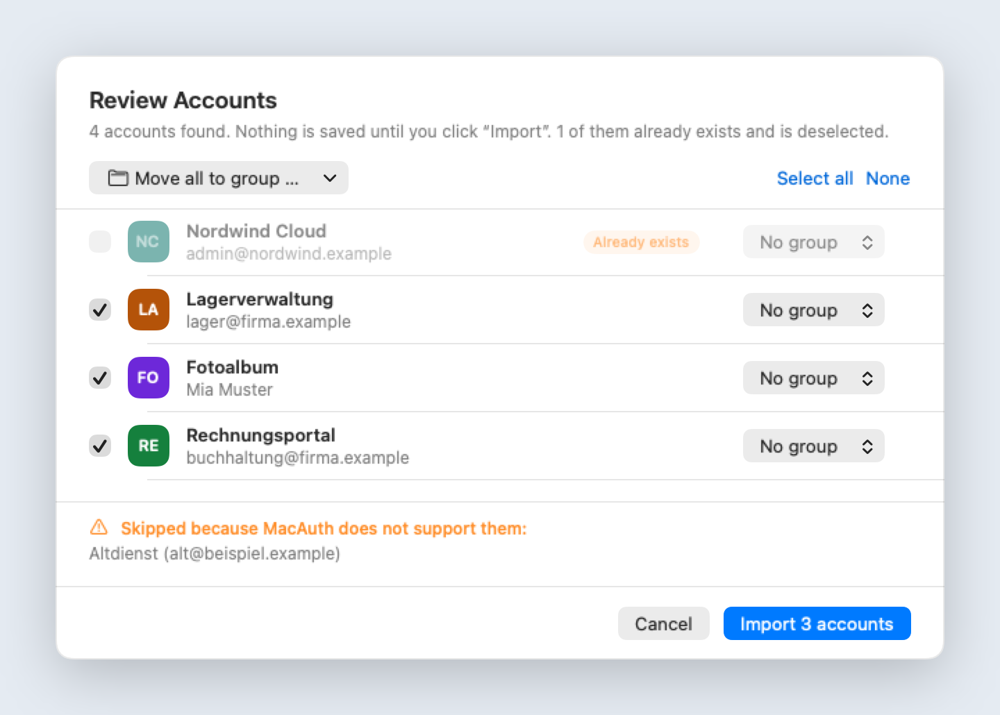
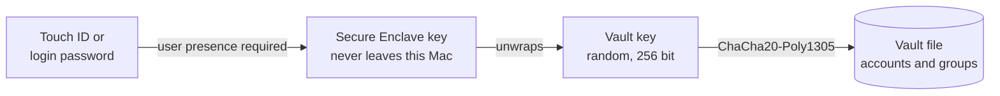

<p align="right"><b>English</b> · <a href="README.de.md">Deutsch</a></p>

<p align="center">
  
</p>

<h1 align="center">MacAuth</h1>

<p align="center">
  <b>Two-factor codes on your Mac.</b><br>
  Local, encrypted with the Secure Enclave, one keystroke away.
</p>

<p align="center">
  <a href="https://github.com/fbrogno/mac-auth/releases/latest/download/MacAuth.dmg"></a>
</p>

<p align="center">
  macOS 15 or later · Apple Silicon and Intel · notarized by Apple · free, MIT
</p>

<p align="center">
  <a href="https://github.com/fbrogno/mac-auth"></a>
  <a href="https://github.com/fbrogno/mac-auth/releases/latest"></a>
  <a href="https://github.com/fbrogno/mac-auth/releases"></a>
  <a href="https://github.com/fbrogno/mac-auth/actions/workflows/ci.yml"></a>
  <a href="LICENSE"></a>
  
  
</p>

<p align="center">
  <a href="#why-macauth">Why</a> ·
  <a href="#features">Features</a> ·
  <a href="#install-in-30-seconds">Install</a> ·
  <a href="#import-your-codes">Import</a> ·
  <a href="#quick-access">Quick access</a> ·
  <a href="#security">Security</a> ·
  <a href="#faq">FAQ</a>
</p>

<p align="center">
  <picture>
    <source media="(prefers-color-scheme: dark)" srcset="docs/images/demo-dark-en.gif">
    
  </picture>
</p>
<p align="center"><sub>The animation is built from real frames of the app, with invented demo accounts.</sub></p>

MacAuth is a native macOS app for two-factor codes (TOTP/HOTP). It keeps your secrets in an encrypted vault on this Mac only and makes copying a code a single step.

## Why MacAuth

- **Codes where you work.** Click a card, press `↵` or `⌘1`–`⌘9`. With the optional quick access panel, a global shortcut opens a small search over any app: type, press `↵`, the code is on the clipboard and the previous app has the focus again.
- **Your secrets stay on this Mac.** No account, no cloud, no telemetry. On a Mac with a Secure Enclave the vault key is wrapped by a key that never leaves it, and opening the vault needs Touch ID or your login password.
- **Moving in is easy, moving out is possible.** Import from Google Authenticator (camera), Apple Passwords, Aegis, 2FAS, Ente Auth, Bitwarden, andOTP or a CSV file. Export a backup, or transfer accounts back to a phone as QR codes.
- **Open and checkable.** MIT licensed, every release is signed, notarized and comes with a SHA-256 file and a build provenance attestation. The threat model, including what MacAuth does *not* protect against, is written down in [SECURITY.md](SECURITY.md).

## Features

<table>
  <tr>
    <td width="50%" valign="top">
      <picture>
        <source media="(prefers-color-scheme: dark)" srcset="docs/images/first-run-dark-en.png">
        
      </picture>
      <br><b>Start in one step</b><br>
      First start: import from Google Authenticator, restore a backup or add an account by hand. Work and private accounts live in separate groups.
    </td>
    <td width="50%" valign="top">
      <picture>
        <source media="(prefers-color-scheme: dark)" srcset="docs/images/import-review-dark-en.png">
        
      </picture>
      <br><b>Nothing is stored unseen</b><br>
      Every import ends in a review: duplicates are marked, entries that cannot be imported are listed with the reason, and nothing is saved until you confirm.
    </td>
  </tr>
  <tr>
    <td width="50%" valign="top">
      <picture>
        <source media="(prefers-color-scheme: dark)" srcset="docs/images/quick-access-dark-en.png">
        
      </picture>
      <br><b>Quick access</b><br>
      A Spotlight-like panel over any app, opened by a global shortcut or a menu bar icon. Off by default.
    </td>
    <td width="50%" valign="top">
      <picture>
        <source media="(prefers-color-scheme: dark)" srcset="docs/images/settings-dark-en.png">
        
      </picture>
      <br><b>Protection you can see</b><br>
      Auto-lock, clipboard clearing, screen protection and hidden codes are settings you can read, and lowering them needs a fresh authentication.
    </td>
  </tr>
</table>

The screenshots show demo data.

- **Search by typing**, groups and favorites, grid or list view, drag to reorder.
- **Copy** by click, `↵`, `⌘1`–`⌘9`, or the next code with `⌥⌘C`. Copied codes are marked as concealed and cleared from the clipboard after 10, 30 or 60 seconds (or never).
- **Auto-lock** after inactivity (1, 5, 15, 60 minutes or never), and always on sleep, screen lock and user switching.
- **Screen protection:** the window is excluded from screen sharing and screenshots (a request to macOS, no guarantee; can be switched off). Optional: codes shown only on hover or selection.
- **Encrypted backup** with an open, documented format ([docs/backup-format.md](docs/backup-format.md)) that comes with a stand-alone decryption script.
- **Transfer to a phone** as QR codes (Google's migration format, or one `otpauth://` QR per account), and unencrypted export for another app (link list, Aegis JSON, Apple Passwords CSV) after a fresh authentication and a warning.
- **Safe recovery:** if the vault cannot be opened, nothing is deleted. Try again, restore a backup or bring back an earlier version. A replaced vault file is always kept.
- **TOTP and HOTP**, SHA-1, SHA-256 and SHA-512, 6 to 8 digits, periods from 15 to 120 seconds.
- **German and English** interface.

## Install in 30 seconds

<p align="center">
  <a href="https://github.com/fbrogno/mac-auth/releases/latest/download/MacAuth.dmg"></a>
</p>

1. **Download** [MacAuth.dmg](https://github.com/fbrogno/mac-auth/releases/latest/download/MacAuth.dmg) (always the latest release; all versions are on the [releases page](https://github.com/fbrogno/mac-auth/releases)).
2. **Open it** and drag MacAuth to Applications.
3. **Start MacAuth** from Applications.

MacAuth is signed with a Developer ID and notarized by Apple, so macOS does not warn about an unidentified developer. Like for every app downloaded from the internet, macOS may ask once whether you want to open it: click **Open**.

Requirements: macOS 15 or newer, Apple Silicon or Intel (universal app).

## Import your codes

Every import ends in a review step. Nothing is stored until you confirm.

| Coming from | How |
|---|---|
| **Google Authenticator** | On the phone: menu, **Transfer accounts**, **Export accounts**, pick accounts, a QR code appears. In MacAuth choose **Import from Google Authenticator** and scan it with the Mac camera. Several QR codes are counted ("2 of 3"). A screenshot, an image file or a single `otpauth://` link or setup key work too. |
| **Apple Passwords** | In Passwords: **File** > **Export All Passwords to File**. In MacAuth: **From Apple Passwords**, pick the CSV. Only the codes are read; the passwords in the file are ignored and never stored. |
| **Aegis, 2FAS, Bitwarden, andOTP** | Export unencrypted there, then **Import from File …** (also in the **+** menu and the File menu, or drop the file on the window). The format is recognised from the file content. |
| **Ente Auth** | Export the `otpauth://` list, then **Import from File …**. |
| **1Password, Proton Pass, other CSV** | A CSV with a one-time-password column (`OTPAuth`, `totp`, `2fa`, `otp` …) is read; other columns are dropped while parsing. |
| **MacAuth backup** | **Restore Backup** (first start or lock screen), or **Import from File …** to add its accounts. |

Export files from other apps hold every secret in plain text. Delete them after the import, also from the Trash and from iCloud Drive, and do the same with a screenshot of a QR code. Do not delete the accounts from the old app before you have checked that the codes in MacAuth work. Then export a backup (`⇧⌘E`) and store it somewhere safe, with a long password.

Going the other way: **File** > **Export for Another App (Unencrypted) …**, or transfer accounts to a phone as QR codes.

## Quick access

A small panel for the most common job: find an account, copy its code, get out of the way.

- **Opens with a global shortcut** (Settings, General; ⌃⌥Space is suggested; it needs at least one of ⌘ ⌥ ⌃) and, if you like, from a menu bar icon. Off by default; nothing is registered until you turn it on.
- **Type to find an account**, `↵` copies the code, the panel closes and the previous app has the focus again. `⌘1`–`⌘9` copy a row, `⌥↵` copies the next code, `esc` clears or closes.
- **While MacAuth is locked,** the panel shows no account data. It only offers to unlock.
- It needs no accessibility permission, types nothing for you and never reaches the network.

## Keyboard shortcuts

| Shortcut | Action |
|---|---|
| typing | search (`esc` clears) |
| `↑` `↓` `←` `→` | move selection |
| `↵` or `⌘C` | copy code of the selected account |
| `⌘1`–`⌘9` | copy code of the first nine visible cards |
| `⌥⌘C` | copy the next code |
| `⌘F` | focus search |
| `⌘N` / `⇧⌘N` | new account / new group |
| `⇧⌘I` | import |
| `⌘V` | paste an image or link to import |
| `⇧⌘E` | export backup |
| `⌘L` | lock |
| `⌘⌫` | delete the selected account (with confirmation; only when a card is selected and no text field has focus, not in the search field) |
| optional | global shortcut for quick access (Settings, General): typing finds, `↵` copies, `⌘1`–`⌘9` copy a row, `⌥↵` the next code, `esc` clears or closes |
| `⌘,` | settings |

## Security

In plain words:

- The vault is one file, sealed with ChaCha20-Poly1305. On a Mac with a Secure Enclave, the vault key is wrapped by a key that never leaves the enclave. Opening needs Touch ID or the login password, **enforced by the enclave**, not by a check in the app. A copy of the vault file is useless on another device.
- Secrets are never put on the clipboard, only the current code. It is marked as concealed, stays on this Mac (no Universal Clipboard) and is cleared after a short time.
- The backup is AES-256-GCM with a key from your password (PBKDF2-HMAC-SHA256, 600,000 rounds). Its strength is the strength of your password.
- The only third-party code is Sparkle, the updater. The cryptography uses Apple's CryptoKit, CommonCrypto, Security and LocalAuthentication.



Without a Secure Enclave, or if you switch the unlock prompt off, the vault key sits in the login keychain instead. That is weaker, and with Time Machine or Migration Assistant the key can travel to another Mac together with the vault file. The settings show which level is in use.

**What MacAuth does not protect against.** Malware running as you while the vault is unlocked. Someone who knows your login password. Having password and second factor on one device: if that Mac is fully compromised, both are exposed, so think twice for high-value accounts. A weak backup password. And **if you lose the Mac without a backup file, the codes are gone**: the Secure Enclave key cannot be exported, by design. The full list is in the threat model in [SECURITY.md](SECURITY.md), which also explains how to report a vulnerability. The design is in [docs/DESIGN.md](docs/DESIGN.md).

## Updates

MacAuth updates itself with [Sparkle](https://sparkle-project.org). It checks about every 6 hours and shortly after launch. A new version shows up as a notice at the bottom of the sidebar and, by default, is installed when you quit the app. You can switch automatic checks and automatic installation off in Settings, Updates.

Sparkle installs an update only if the download carries a valid EdDSA signature that matches the public key in the installed app, or if the new app is signed with the same Developer ID identity as the installed one. The release pipeline additionally notarizes the app; Sparkle itself does not check notarization. Trust therefore rests on the release pipeline: whoever controls the GitHub repository, the release workflow and its signing secrets could ship an update that every installed copy accepts. If you cannot accept that, switch automatic installation off and install releases by hand after checking them. Details in [SECURITY.md](SECURITY.md#releases).

## Privacy

MacAuth collects no data. The only network connection it opens is the update check against this repository's GitHub Releases. It sends no account data, identifiers or usage data; as with any web request, GitHub sees the request itself, such as your IP address. The camera is used only to scan a QR code when you import accounts; frames are processed on the device and nothing is recorded. See [PRIVACY.md](PRIVACY.md).

## Verify your download

Each release carries a SHA-256 file and a build provenance attestation from GitHub Actions (Sigstore). In the folder with the download:

```bash
# Is the file from this repository's release workflow?
gh attestation verify MacAuth.dmg --repo fbrogno/mac-auth

# Does the hash match? Compare with the value in MacAuth-<version>.dmg.sha256 on the release page.
shasum -a 256 MacAuth.dmg

# Signature and notarization of the DMG
spctl -a -vv -t open --context context:primary-signature MacAuth.dmg
```

`MacAuth.dmg` is a byte-identical copy of `MacAuth-<version>.dmg`, so both checks work for either file name. More in [docs/RELEASING.md](docs/RELEASING.md) (German).

## Build from source

You need macOS 15+, Xcode and [XcodeGen](https://github.com/yonaskolb/XcodeGen).

```bash
swift test                               # tests for AuthCore
SIGN_IDENTITY=- ./scripts/build-app.sh   # build/MacAuth.app, ad-hoc signed
```

Try it without touching a vault: `build/MacAuth.app/Contents/MacOS/MacAuth --demo` opens the real window with invented accounts, entirely in memory (no vault, keychain or Secure Enclave, nothing is stored). `--render-docs <folder>` draws the documentation images from the same views.

## FAQ

<details>
<summary><b>Is my data sent anywhere?</b></summary>

No. Accounts, secrets and codes never leave your Mac. The only connection MacAuth opens is the update check against GitHub Releases, which sends no account data or identifiers. See [PRIVACY.md](PRIVACY.md).
</details>

<details>
<summary><b>What if I lose my Mac?</b></summary>

Without a backup file, the codes are gone: the Secure Enclave key cannot be exported, which is intended. Export an encrypted backup (`⇧⌘E`) and keep it somewhere safe, with a long password. On a new Mac you restore it with **Restore Backup**. MacAuth reminds you when there is no backup of the latest changes.
</details>

<details>
<summary><b>Can I move back to my phone?</b></summary>

Yes. **Transfer to Phone** shows QR codes in Google's migration format, or one `otpauth://` QR code per account. Accounts that Google's format cannot hold (for example other periods than 30 seconds, or 7 digits) are refused rather than changed silently; they can be transferred as single QR codes. You can also export a file for another app.
</details>

<details>
<summary><b>Why does it ask for Touch ID?</b></summary>

On a Mac with a Secure Enclave, the key that protects the vault key can only be used after Touch ID or the login password. That is enforced by the enclave, not by a check in the app, and it is what makes a copy of the vault file useless elsewhere. If the sensor does not work, the login password does.
</details>

<details>
<summary><b>Does it sync between my Macs?</b></summary>

No. There is no cloud and no sync. The vault is bound to one Mac; to use the same accounts elsewhere, restore a backup there.
</details>

<details>
<summary><b>Can I switch off Touch ID or the auto-lock?</b></summary>

You can lower protection in Settings, but each step needs a fresh authentication, and the setting is stored inside the encrypted vault so editing preferences files cannot lower it. Switching the unlock prompt off puts the vault key in the login keychain, which is weaker (see Security above).
</details>

<details>
<summary><b>The quick access shortcut does nothing.</b></summary>

Another app may already use the same key combination; macOS does not tell MacAuth. Pick another one in Settings, General.
</details>

<details>
<summary><b>Does MacAuth work with my service?</b></summary>

With any service that offers standard authenticator-app codes (TOTP or HOTP, RFC 6238 and RFC 4226). Steam-style codes are not supported; such entries are listed as unusable during an import.
</details>

## Contributing

Bug reports and small, focused pull requests are welcome; for anything bigger, please open an issue first. See [CONTRIBUTING.md](CONTRIBUTING.md) for the layout, style and how to send a pull request. Found a security problem? Please do not open a public issue; see [SECURITY.md](SECURITY.md).

If MacAuth helps you, a star on GitHub helps others find it:

<p align="center">
  <a href="https://github.com/fbrogno/mac-auth"></a>
</p>

## License

[MIT](LICENSE). MacAuth is not affiliated with Google. "Google Authenticator" is a trademark of Google LLC.
